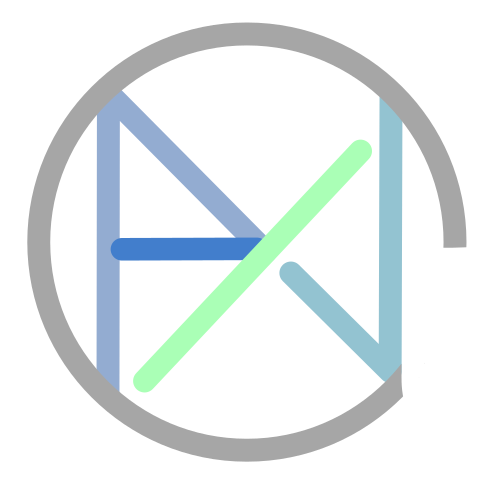

<div align="center">

# 🔷 Geowar · 几何战争


**Feel the beauty of geometry.**

一个使用 [Godot 4.7](https://godotengine.org/) + C# 开发的 2D 几何战争类游戏。
以「点」「线」「面」三种几何形态作为武器，在霓虹般的几何战场上抵御一波波敌人的进攻。



</div>

---

## 📖 简介

**Geowar** 是一个以几何图形为核心战斗机制的双摇杆式 2D 生存游戏。玩家控制一簇几何体，
用鼠标瞄准、`Shift` 蓄力强攻，在屏幕中游走闪避并消灭不断来袭的敌人。击杀敌人会掉落
金属、金币、钻石、绿宝石等资源，可用于在商店中永久升级你的形态。

> 项目仍处于早期开发阶段（`0.0.3`），目前 **点** 与 **线** 两种形态已经可以游玩，
> **面（多边形）** 形态仍在开发中。

---

## ✨ 特性

- 🕹️ **三种几何形态**：点 (Point)、线 (Line)、面 (Polygon)——每种形态拥有独立的攻击与技能逻辑
- 🔥 **强攻（蓄力）系统**：按住 `Shift` 释放强化攻击，蓄力时长影响威力与范围
- 🛒 **商店与升级系统**：使用战斗掉落货币购买永久强化，升级会提升整体游戏难度
- 👾 **自适应难度敌人**：普通 / 超级 / 极限 三种敌人等级，随难度提升而强化
- 💎 **货币系统**：金属、金币、钻石、绿宝石，支持升级与货币兑换
- 🎨 **霓虹视觉风格**：世界环境光晕 (Glow)、自绘几何图形、动态血条
- 🎵 **Undertale / Deltarune 风格配乐**：按关卡状态自动切换 BGM

---

## 🎮 操作方式

| 操作 | 效果 |
|------|------|
| `W / A / S / D` | 移动 |
| 鼠标移动 | 瞄准 |
| **鼠标左键** | 普通攻击 |
| **鼠标右键** | 特殊攻击 / 预瞄 |
| `Shift` + 左键 | 强攻（满弹时发射全部子弹） |
| `Shift` + 右键 | 强攻 / 技能 |
| `Esc` | 暂停 |
| `F11` | 全屏切换 |

> 提示：将鼠标移动到画面边缘会自动隐藏光标（可在设置中关闭），屏幕边缘即为攻击瞄准方向。

---

## 🧊 形态与玩法

### 点 (Point) — 已实现

初始拥有多个「点」围绕中心旋转。左键甩出最靠近瞄准切线方向的点作为子弹；
`Shift` + 左键在全满弹状态下一次性甩出所有点。被击毁的子弹会随着时间重新生成。

| 攻击 | 说明 |
|------|------|
| 左键 | 依旋转方向甩出一个「点」作为子弹 |
| `Shift` + 左键 | 满弹时发射全部点 |
| 商店强化 | 点数上限、子弹伤害、磨刀（点自身可蹭伤敌人） |

### 线 (Line) — 已实现

由多条线段环绕核心形成的「刺球」。右键进入预瞄状态，所有线段面向鼠标方向聚拢；
此时再按左键即可将线段作为 **穿透性子弹** 发射（线段带有穿透等级）。`Shift` + 左键一次性发射全部。

| 攻击 | 说明 |
|------|------|
| 左键 + 右键 | 发射一条穿透敌人的线段 |
| `Shift` + 左键 + 右键 | 满弹时发射全部线段 |
| 商店强化 | 线段数量、穿透等级、线形态解锁 |

### 面 / 多边形 (Polygon) — 开发中

设计为多边形闭合区域围绕核心旋转，计划支持顶点齐射、收缩膨胀等技能。当前仅有基础
碰撞体与渲染脚本，具体玩法尚在开发中（见 `Goal.md`）。

---

## 🛒 商店与升级

战斗掉落 `金属 / 金币 / 钻石 / 绿宝石`，在商店中购买升级（部分为角色专属）。升级进度会
反哺为游戏 **难度系数**，难度越高敌人越强。

| 货币 | 升级项 | 说明 |
|------|--------|------|
| 金币 | 骨质增生 / 延展 | 点 / 线数量 +1 |
| 金币 | 碎裂加速 | 射速 +1 |
| 金币 | 漂移 | 移动速度 +20 |
| 钻石 | 骨刺淬毒 | 子弹伤害 +1 |
| 钻石 | 线 | 解锁「线」形态 |
| 钻石 | 磨刀石 | 点可蹭伤敌人 |
| 钻石 | 一箭穿心 | 线穿透 +2 |
| 钻石 | 核弹支援 | 随机呼叫火力支援（技能） |
| 绿宝石 | 骨骼硬化 | 最大生命值提升 |
| 绿宝石 | 噬血骨刺 | 击杀回复生命值 |
| 绿宝石 | 上帝视角 | 扩大视野 10% |

---

## ⚙️ 技术栈

| 类别 | 内容 |
|------|------|
| 引擎 | [Godot 4.7](https://godotengine.org/)（Forward+，C# 支持） |
| 语言 | C#（.NET / Mono），少量 GDScript（UI / 编辑器插件） |
| 渲染 | D3D12 (Windows)，WorldEnvironment Glow 光晕 |
| 物理 | 2D 物理（RigidBody2D 驱动玩法实体） |
| 数据持久化 | `ConfigFile` → `user://坠母.cfg` |
| 场景过渡 | EasyTransition 插件（模糊转场） |

**主要插件 (addons)：**
- `easytransition` — 场景切换过渡动画
- `RoundedPolygon2D` — 圆角多边形绘制
- `gaussian-blur` — 高斯模糊合成器
- `external_shader_editor` / `scene_dependency_viewer` / `rider-plugin` — 编辑器工具

---

## 📁 项目结构

```
Geowar/
├── project.godot          # 工程配置（输入映射、自动加载、图层）
├── Goal.md                # 游戏设计文档
├── export_presets.cfg     # Windows 导出预设
├── addons/                # Godot 插件
├── animation/             # 动画资源 (.anim / .res)
├── fonts/                 # 字体（BoutiqueBitmap 像素风）
├── gdscripts/             # GDScript（UI、菜单、主菜单逻辑）
├── scripts/               # C# 核心逻辑
│   ├── mainGame/          # 战斗核心（Player / Enemy / 形态 / 掉落 / 技能）
│   └── mainMenu/          # 主菜单、商店、标题、设置
├── scenes/                # 场景
│   ├── main_game.tscn     # 主战斗场景
│   ├── main_menu.tscn     # 主菜单
│   └── main/              # 玩家形态、敌人、掉落物、UI 子场景
├── sounds/                # 音频（UI / Deltarune / Undertale / MC 风格）
├── texts/                 # 角色文本数据 (character.json)
└── texture/               # 纹理 / SVG / 光标 / 标题图
```

**核心脚本一览：**
- `GameManager.cs` — 全局游戏状态、难度、玩家数据（Autoload）
- `SignalManager.cs` / `DataManager.cs` / `GlobalAudioPlayer.cs` — 信号、存档、音频（Autoload）
- `Player.cs` — 玩家基类（血量、移动、受击）
- `PointPlayer.cs` / `LinePlayer.cs` — 点 / 线形态实现
- `Enemy.cs` / `EnemySummoner.cs` — 敌人 AI 与波次生成
- `MainMenuShop.cs` — 商店目录、购买 / 出售、难度计算

---

## 🚀 运行 / 构建

**前置要求：**
- [Godot 4.7](https://godotengine.org/download) 且 **支持 .NET (C#)**
- .NET SDK（用于编译 C# 脚本）

**运行：**
1. 用 Godot 4.7 打开本项目根目录（`project.godot`）。
2. 首次打开后导入资源并编译 C#（`Build` 或编辑器自动编译）。
3. 直接按 `F5` 运行主场景。

**导出 Windows：**
- 使用内置 `Windows Desktop` 导出预设（x86_64），导出后生成 `Geowar.exe`。
- 可在右侧 **Release** 栏下载预编译版本。

---

## 🗺️ Roadmap

- [x] 点形态完整玩法
- [x] 线形态完整玩法
- [x] 商店 / 升级 / 货币系统
- [x] 难度驱动的敌人系统
- [ ] 面（多边形）形态
- [ ] 更多敌人类型与 Boss
- [ ] 更多技能与蓄力特效
- [ ] 手柄 / 移动端（虚拟摇杆）适配优化

设计细节见 [`Goal.md`](./Goal.md)。

---

## 📄 License

本仓库代码基于 [MIT License](./license)。
